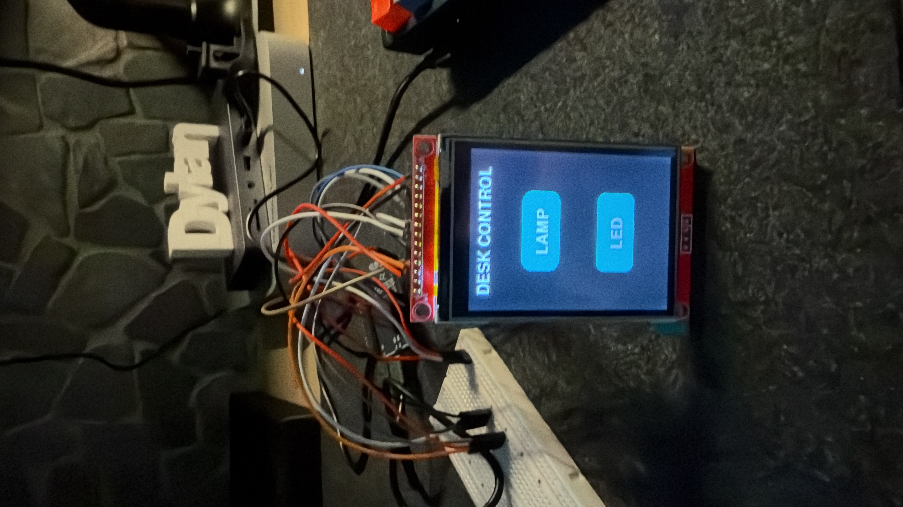

# ESP32-S3 Touchscreen Interface

I'm building a touchscreen interface with an ESP32-S3 as part of learning C++ and embedded software engineering.

I started with a Freenove ESP32-S3 development board and a small 2.8-inch TFT display. Rather than jumping straight into a finished interface, I'm working through the basics: checking the power supply, uploading code, getting the display working over SPI, and reading touches from the screen.

My longer-term goal is to use what I learn here in bigger projects, including a facial-recognition door lock. This repository is a record of what I actually tested, the problems I ran into, and how I worked through them.

## Current progress

**In progress — the display works, my simple control-panel design is on screen, and I've now tested touch input successfully. The buttons are not interactive yet.**

| Milestone | Result |
| --- | --- |
| Set up ESP32-S3 in Arduino IDE | Completed |
| Upload and run a basic C++ sketch | Completed |
| Confirm readable output in Serial Monitor | Completed |
| Measure the board's 3.3V supply | Completed |
| Power the TFT backlight | Completed — white illuminated screen |
| Send drawing commands to TFT over SPI | Completed guided first graphics test — full-screen blue |
| Read touchscreen input | Completed first test — touch presses show X/Y readings in Serial Monitor |
| Calibrate touch coordinates | Not started — need to measure all four corners |
| Make LAMP and LED respond to touch | Not started |
| Build a simple graphical interface | In progress — heading and two visual buttons, experimenting with fonts, colours and positioning |

The first ILI9341 graphics test coloured only part of the panel and left static below. Testing with Adafruit ST7789 filled the full panel, although the requested blue initially appeared yellow. Adding `tft.invertDisplay(false)` produced a full-screen blue result. This demonstrates a compatible software configuration, **not definitive identification of the controller IC**. On 23 November, I also got a separate touchscreen test working and could read touch positions in Serial Monitor.

## Hardware

- Freenove ESP32-S3-WROOM development board
- 2.8-inch 240 × 320 TFT module with SPI interface, board marked V1.1
- USB-C data cable, jumper wires, breadboard and multimeter

The display controller's marking is **not yet confirmed**, but the Adafruit ST7789 library produces a full-screen image using `tft.init(240, 320)` and `tft.invertDisplay(false)`. The touch-controller part number also remains unverified.

See [hardware notes](docs/HARDWARE.md) for the connections tested so far and what remains to be verified.

## Software

- C++ using Arduino IDE
- ESP32 board package by Espressif Systems
- Board target used: `ESP32S3 Dev Module`
- `USB CDC On Boot` disabled for the working serial and touchscreen tests on my current USB connection
- Serial Monitor set to **115200 baud**
- Adafruit GFX + Adafruit ST7735/ST7789 library for the first working graphics test
- XPT2046_Touchscreen library for the touch test (exact touch-controller chip not confirmed)

### First working test

My first successful upload was a small serial-output sketch. It prints a startup message and then repeats a message every second, which let me confirm that the board was actually running my program.

The [serial smoke-test sketch](src/serial_smoke_test/serial_smoke_test.ino) is the guided example I uploaded and verified on the board. It's not touchscreen code.

### First successful graphics test

I followed a guided [ST7789 full-screen colour test](src/st7789_colour_test/st7789_colour_test.ino). With SPI wires connected, the first driver choice only updated part of the screen. The alternative driver filled the display, and switching off inversion gave the intended blue. The sketch in this repository records the working configuration presented during the exercise.

### My first on-screen control layout — 22 November 2026

I moved on from filling the screen with a solid colour to making something that looks more like a control panel. I added a heading and two buttons using Adafruit GFX.

Getting the buttons and text positioned properly took more trial and error than I expected. I was adjusting the X/Y coordinates, rectangle sizes and the text cursor, then uploading the sketch to see how each change looked on the actual screen.

One problem took a while to figure out: I was drawing the text **before** drawing the button underneath it. The button was then being drawn over the top and covering the text. I eventually realised the order of drawing instructions matters. Drawing the button first and the label afterwards solved that part.

I also experimented with Adafruit's built-in colours, custom green shades using `color565()`, and different FreeSans Bold font sizes. I'm starting to understand how coordinates, font size and drawing order all affect the finished layout.

**Current result:** A heading and two drawn buttons. These are visual elements only — they don't respond to touch or switch any electrical outputs yet.

**Project photo — 22 November 2026:** My first desk control layout, showing the `DESK CONTROL` heading and the two `LAMP` and `LED` buttons running on the actual 2.8-inch TFT display.

*The buttons are drawn on-screen but are not touch-sensitive yet.*

### Getting the touchscreen working — 23 November 2026

Today I started working on the touch part of the screen. The goal is to eventually press the `LAMP` and `LED` buttons I've already drawn, instead of just having them sit there.

I connected four more wires for the touch side of the display. Two of them share the same SPI connections as the screen itself, while the touch controller has its own chip-select pin. I used GPIO 12 for `T_CLK`, GPIO 11 for `T_DIN`, GPIO 13 for `T_DO` and GPIO 14 for `T_CS`. I left `T_IRQ` disconnected.

I made a separate touch-test sketch so I wouldn't lose the control-panel design I'd already worked on. At first it wasn't working properly. The display was white, and Serial Monitor either showed startup messages, strange characters or nothing useful. That made it hard to tell whether the touch code was actually running.

I went back to a simple test that printed a message every second. The sketch uploaded successfully, but I still couldn't see the messages. I checked the baud rate and USB settings, then tried disconnecting the new touch wires to see if they were causing the problem. That didn't change anything. **Changing `USB CDC On Boot` to Disabled and uploading again fixed the serial output** with my current setup.

After that I put the touch wires back and tried the touchscreen test again. This time it worked. When I pressed different parts of the screen, I could see the X and Y readings changing in Serial Monitor.

I also learned what those readings are useful for. The X and Y values tell me where the screen was pressed. If I know the area covered by a button, I can check whether a press happened inside it. The readings from the touch test are still raw numbers, though, so they need to be matched up with the screen's drawing coordinates first.

**Where I stopped:** Touch detection works, but I haven't measured the four corners to calibrate it yet. I also haven't added touch handling to my original `DESK CONTROL` sketch, so the `LAMP` and `LED` buttons are still just graphics. I haven't connected any relays or powered devices.

## Development record

- [Development log](CHANGELOG.md) — dated tests, observations and troubleshooting
- [Hardware notes](docs/HARDWARE.md) — components, tested power connections and outstanding checks
- [Learning portfolio](https://github.com/DylanParenzee/embedded-cpp-learning) — my broader Arduino and C++ progress

## Next milestone

The display and basic touch test are now working separately. Next I'll record touch readings from the four corners, work out how they match the display coordinates, and then try detecting presses on my existing LAMP and LED buttons. Connected device switching will come later.

I'll add photos, diagrams and more code as I test each part of the system. For now, this repository documents an early working display milestone, not a completed interface.
